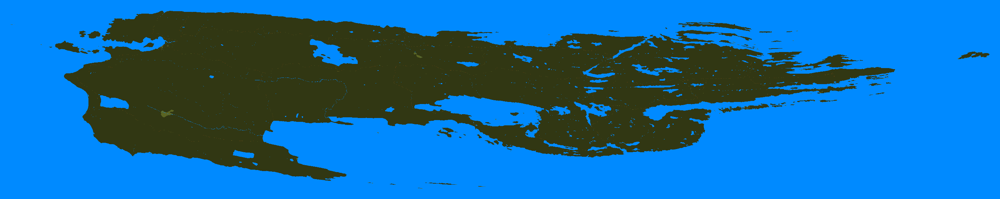
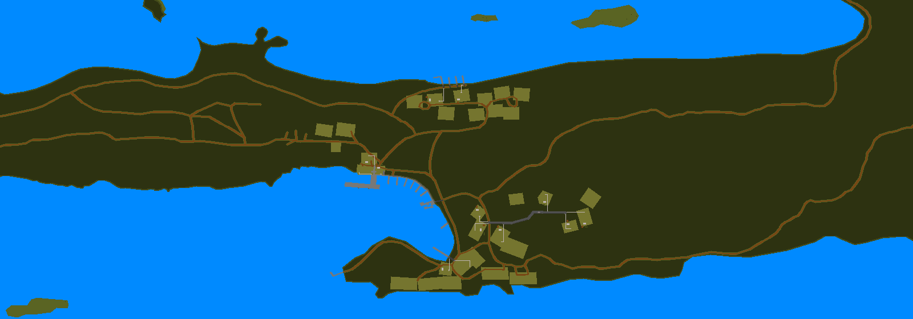
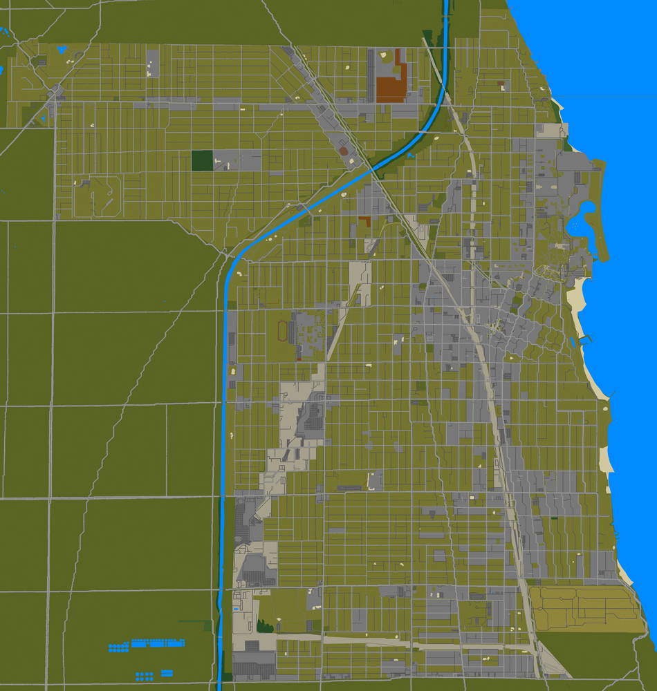
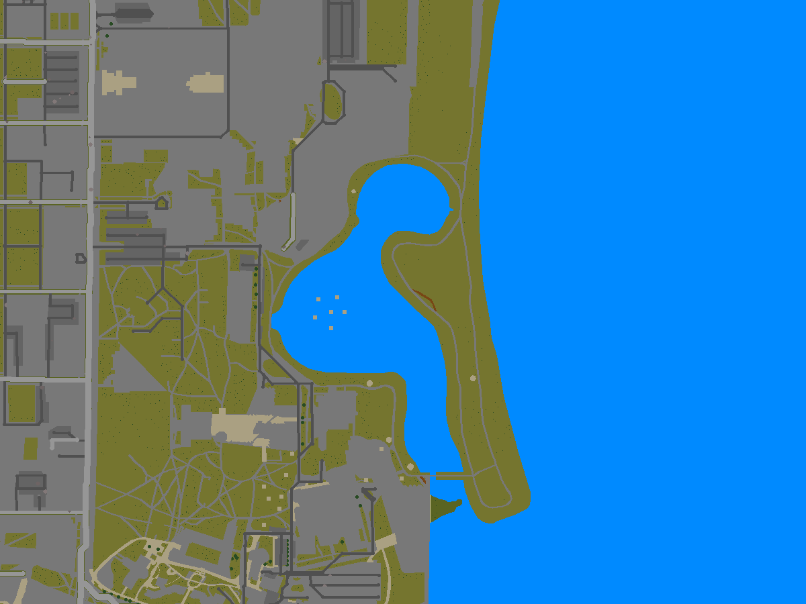

# Real places for Project Zomboid

Build 42 maps of real places at one tile to the metre, made with
[KnoxMap](https://github.com/badnew21/KnoxmapDM) from
[Overture Maps](https://overturemaps.org) data. KnoxMap itself is not changed.

| Map | What it is | Download |
|---|---|---|
| [Isle Royale](#isle-royale) | Isle Royale National Park, Michigan: 570 km² of island wilderness in Lake Superior | `release/IsleRoyale.7z.001`–`.005` (425 MB, 11 GB unpacked) |
| [Evanston](#evanston) | Evanston, Illinois: the whole city inside its real boundary, on Lake Michigan | `release/Evanston.7z` (41 MB, 690 MB unpacked) |

The two sit side by side in the game world, so both mods can be installed at
once. See [Installing](#installing) for how to put one in the game.

# Isle Royale

A map of Isle Royale National Park, Michigan, at one tile to the metre. It
covers the whole island and its outer islands, from the Rock of Ages
lighthouse in the southwest to Passage Island in the northeast: about 570 km²
of land.





KnoxMap is made for towns of a few square kilometres, and the island is 86 km
long once it is laid out on the tile grid, so the pipeline hands KnoxMap the
island one piece at a time and stitches the pieces back together.

## What is on the map

- **The shoreline, over a hundred islands and rocks, and the inland lakes**: Siskiwit,
  Desor, Richie, Chickenbone, Feldtmann and the rest, with the streams between
  them.
- **Forest almost everywhere**, as on the real island, with bogs and wetlands,
  open rock ridges and a few beaches.
- **The trail network**: Greenstone Ridge, Minong Ridge, Feldtmann Ridge,
  Rock Harbor, Indian Portage and the access trails. Trails are bare dirt
  through the trees, and they are named on the in-game map like streets.
- **Rock Harbor, Mott Island and Windigo**: the lodge, cabins, store, ranger
  stations and docks. Each building is a furnished building, made by
  KnoxMap's knoxbuild on its real footprint.
- **Campgrounds** as clearings: Daisy Farm, Moskey Basin, Three Mile, Lake
  Desor, Chickenbone Lake and others.
- **Lighthouses and outlying buildings**: Rock of Ages, Isle Royale Light,
  Rock Harbor Light, Edisen Fishery and the fire towers.
- **An in-game map (M)** of the whole island, labelled with its harbours,
  lakes, islands, peaks, campgrounds and trails.
- **Zombies** where people would be: some at Rock Harbor and Windigo (KnoxMap's
  population estimate), a few along the trails and at the campgrounds, and
  almost none in the deep woods.

### Where you start

On the new-game screen you can choose where to start. Each place is its own
spawn region:

- **Rock Harbor** and **Windigo**, the ferry landings, starting inside one of
  their buildings.
- **20 campgrounds** along the trails, from Washington Creek and Huginnin Cove
  in the west to Daisy Farm, Moskey Basin and Lane Cove in the east, starting
  in the clearing.
- **Isle Royale** itself, for a random start at any of them.

Every start point is checked against the map as built: on a floor tile inside
a building that knoxbuild actually made, or on open grass with no tree,
building or water on it. All of them are on the main island, so nobody starts
somewhere they can't leave. Each region is a small map folder beside the
island's own (`Isle Royale - Daisy Farm Campground` and so on), the way
vanilla does Riverside and Rosewood: it borrows the island's lot files and has
its own spawn points (`pipeline/regions.py`).

### Things to know

- **North is turned 30°.** The island runs southwest to northeast, so the map
  is rotated until that long axis runs left to right. A north-up frame would
  have been 65 × 40 km, mostly water.
- **Open lake is left out.** Every cell holding land keeps one cell (256 m) of
  water around it. Cells further out are not part of the map, since no one can
  get out there. Each of those empty cells would otherwise add about 300 KB of
  water to the mod.
- **The outer islands are out of reach.** Project Zomboid has no boats, so
  the Rock of Ages lighthouse, Passage Island and the outer islands can be
  seen from shore but not visited. The same goes for Mott Island and the
  islands across the Rock Harbor channel.
- **The woods are broadleaf only for now.** Trees are paper birch (most of
  them), red maple and linden, drawn from Build 42's per-species tree sheets.
  The real island is largely spruce and fir. Build 42 has hemlock and pine
  sheets, but they are laid out differently from the broadleaf ones and are
  left out until someone checks them in the game (`pipeline/rules.py`).
- **There is no elevation.** Build 42 maps are flat, so the ridges show only as
  bare rock and scrub.
- **The map is large.** See [Size](#size) below.

## Building it

You only need this to change the map or rebuild it from fresher data.
Nothing has to be done by hand. On 4 cores and 16 GB of memory the
whole build took about 40 minutes. It needs about 20 GB of free disk: 9 GB for
the two island-wide bitmaps and 11 GB for the lot files. On the same drive,
the mod folder hard-links the lot files instead of copying them.

You need:

- **KnoxMap** set up as its README describes (`Setup.bat`, or `./setup.sh` on
  Linux and macOS). Setup provides the Python environment and the PZ Mapping
  Tools. The pipeline reads the tools' `Rules.txt` and `Blends.txt`.
- **knoxlots**, KnoxMap's lot compiler. KnoxMap releases ship it beside
  `KnoxMap.exe`. In a git checkout, build it with
  `cargo build --release` in `rust/knoxlots`.
- **pyarrow** in KnoxMap's environment:
  `.venv\Scripts\python -m pip install pyarrow`

Then point the pipeline at KnoxMap and run it:

```bat
set KNOXMAP_DIR=C:\path\to\KnoxMap
%KNOXMAP_DIR%\.venv\Scripts\python pipeline\build_island.py --mods-dir %USERPROFILE%\Zomboid\mods
```

On Linux or macOS:

```sh
export KNOXMAP_DIR=~/KnoxMap
$KNOXMAP_DIR/.venv/bin/python pipeline/build_island.py --mods-dir ~/Zomboid/mods
```

Then enable **Isle Royale** under Mods and start a new game on it.

The stages run in order, and each one keeps its results under `work/`. If a
run stops, run the same command again to carry on. To redo one step after a
change, use `--stages`:

| Stage | What it does |
|---|---|
| `fetch` | Downloads the park's data from Overture Maps into `data/overture`. A copy is already checked in, so this is only needed for fresher data. |
| `terrain` | Draws the island in 2.4 km strips with KnoxMap's renderer and stitches them into one ground and one vegetation bitmap. |
| `buildings` | Draws each cluster of buildings again as its own KnoxMap map, runs knoxbuild on it, and pastes the result back. |
| `spawn` | Makes the zombie spawn map. |
| `papermap` | Writes the in-game map and its labels, and picks the start points for each spawn region. |
| `compile` | Compiles the lot files with knoxlots, a few rows of cells at a time. |
| `mod` | Packages the mod with KnoxMap's own `make_map_mod`, and adds a spawn-region folder for each place. |

`--workers N` sets how many processes compile at once. `--render-workers N`
sets how many strips are drawn at once; each takes about 2.5 GB.

## How it works

Everything is placed in one fixed frame: a rectangle of whole 300-tile cells
in UTM zone 16N, turned 30° about its centre (`pipeline/isle.py`). A window is
any rectangle of that frame. `SectionProjector` is a KnoxMap `Projector` that
places latitude and longitude on a window's pixels exactly where the whole
frame would put them, so windows drawn on their own line up to the tile. While
a window is rendered or built, KnoxMap's `Projector.build` returns that
window's projector, so the renderer and knoxbuild work on it as if it were an
ordinary map.

The data is [Overture Maps](https://overturemaps.org): OpenStreetMap's
coastline, lakes, wetlands, trails, docks and buildings, plus ESA WorldCover
forest cover. `pipeline/overture_fetch.py` reads the GeoParquet files straight
from Overture's public S3 bucket with HTTP range requests. It downloads only
the row groups that overlap the park, so no DuckDB is needed.
`pipeline/isle.py` turns the rows into KnoxMap's `OSMFeature`s with OSM tags,
so KnoxMap's own classifier and painters draw them.

The compile uses its own copy of the map tools' `Rules.txt`, with the forest
tiles set to Build 42 tree sheets (`pipeline/rules.py`). The tools' shipped
rules use a tree sheet Build 42 no longer has artwork for. This way the build
doesn't depend on KnoxMap's Setup having patched them, and the tools' own files
stay unchanged.

KnoxMap was written for towns, so `pipeline/tidy.py` adds a few wilderness
rules. Trees are cleared off the trails, campgrounds keep only a few trees,
and each building stands in a small grass clearing.

## Size

| | |
|---|---|
| Frame | 85,800 × 17,100 tiles (286 × 57 KnoxMap cells) |
| Land | about 570 km² |
| Build 42 cells compiled | 10,975 (of 22,500 in the frame; the rest are open lake) |
| Buildings | 198, plus their fences and docks (286 lots), in 25 clusters from Rock of Ages to Passage Island |
| Mod on disk | 11 GB |
| Build time | terrain 14 min, buildings 1 min, compile 27 min (4 cores) |

Project Zomboid needs extra memory for a map this size. KnoxMap writes a
`HOW TO PLAY.txt` into the mod that says how to give the game more.

# Evanston

Evanston, Illinois, at one tile to the metre: the whole city inside its real
boundary, about 20 km², from the Lake Michigan shore to the North Shore
Channel.





A town this size is what KnoxMap is made for, so it runs KnoxMap's own steps
the way the app does. `pipeline/build_town.py` feeds it Overture Maps data
instead of a live OpenStreetMap download.

## What is on the map

- **Every street**, at its real width, with pavements and kerbs. KnoxMap lays
  the streets in straight runs and 45° corners, like the game's own map.
- **21,582 buildings**, each furnished: 16,042 houses, 3,341 blocks of flats,
  588 shops, 179 school buildings, 55 churches, garages and sheds. Heights are
  real for 87% of them, up to 14 storeys downtown.
- **Shops and businesses inside them**: about 3,700 of Overture's places become
  the restaurants, cafes, bars, groceries, pharmacies, banks, clinics, salons,
  gyms and offices knoxbuild fits out. 425 buildings are furnished this way.
- **Northwestern University**, downtown, the lakefront parks and beaches, and
  Calvary Cemetery.
- **The CTA Purple Line and the Metra tracks**, with 47 bridges where roads
  and rail cross over each other.
- **22,146 parking spots**, so cars spawn on the streets and in the lots.
- **Zombies by population**, from KnoxMap's estimate of who lived and worked in
  each building. It is a city, so there are a lot of them: about 41% of the
  map's chunks have some.
- **An in-game map (M)** with 521 named streets.

### Things to know

- **The map stops at the city line.** Outside Evanston's boundary, KnoxMap
  turns the neighbouring towns (Skokie, Wilmette, Chicago's Rogers Park) back
  into open ground. The main roads carry on across it.
- **The streets are slightly simplified.** KnoxMap's "Knox County roads"
  setting is on, so curves such as Sheridan Road become straight runs with 45°
  corners, a few metres off their real line.
- **Interiors are generic.** Rooms suit what a building is, not the real
  building's layout.
- **The data is Overture's.** Overture Maps is OpenStreetMap plus extras. The
  buildings and streets are complete, but businesses only appear where Overture
  places a point inside the building.

## Size

| | |
|---|---|
| Map | 5,700 × 6,000 tiles, 545 Build 42 cells |
| Mod on disk | 690 MB |
| Build time | render 2 min, knoxbuild 7 min, compile 15 min (4 cores) |

## Building it

```sh
$KNOXMAP_DIR/.venv/bin/python pipeline/build_town.py evanston --mods-dir ~/Zomboid/mods
```

The stages are `fetch`, `render`, `buildings`, `compile` and `mod`. The
Overture data for Evanston is checked in under `data/evanston`. Another town
can be added to `TOWNS` in `pipeline/build_town.py` with its name in
Overture's divisions, a box to fetch, KnoxMap settings and a free spot in the
world.

# Installing

Both maps are in [`release/`](release) as 7-Zip archives. Isle Royale is split
into five parts (`IsleRoyale.7z.001` to `.005`) to stay under GitHub's file
size limit.

1. Download the archive. For Isle Royale, download every part into one folder.
2. Open it with [7-Zip](https://www.7-zip.org): `Evanston.7z`, or
   `IsleRoyale.7z.001`, which reads the other parts by itself. On Linux, use
   `7z x <file>`.
3. Extract the folder inside (`Evanston` or `IsleRoyale`) into your Zomboid
   mods folder: `%USERPROFILE%\Zomboid\mods` on Windows, `~/Zomboid/mods` on
   Linux and macOS.
4. Start Project Zomboid (Build 42), enable the map under Mods, and start a
   **new** game on it.

If you downloaded Isle Royale before the start locations were added, you
don't need the whole archive again. Extract
`release/IsleRoyale-spawn-regions-update.zip` (17 KB) into your mods folder
over the existing `IsleRoyale` folder and let it replace files. Then start a
new game.

Read `HOW TO PLAY.txt` in the mod folder first. Maps this size need more
memory than the game gives itself by default, and the file says how to raise
it.

# Credits and licences

- Map data © OpenStreetMap contributors, under the
  [ODbL](https://www.openstreetmap.org/copyright), as published by Overture
  Maps. Evanston's boundary is from Overture Maps' divisions theme.
- Forest cover © ESA WorldCover project 2021, contains modified Copernicus
  Sentinel data, [CC BY 4.0](https://creativecommons.org/licenses/by/4.0/),
  via Overture Maps.
- [KnoxMap](https://github.com/badnew21/KnoxmapDM) by euclid80tr, MIT. It is
  built on Knoxify by arytek and on the PZ Mapping Tools by Alree/Unjammer
  (TileZed and WorldEd by Tim Baker).
- Project Zomboid is a trademark of The Indie Stone. This is an unofficial fan
  map and contains no game files.

These are real places. The zombies are made up, and so is everything inside
the buildings. Isle Royale's wolves and moose are real, but they are not in
the game.
