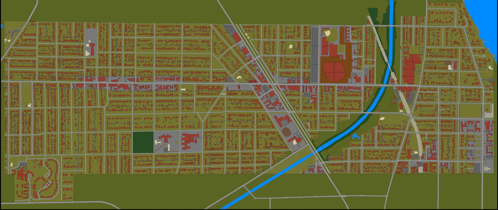
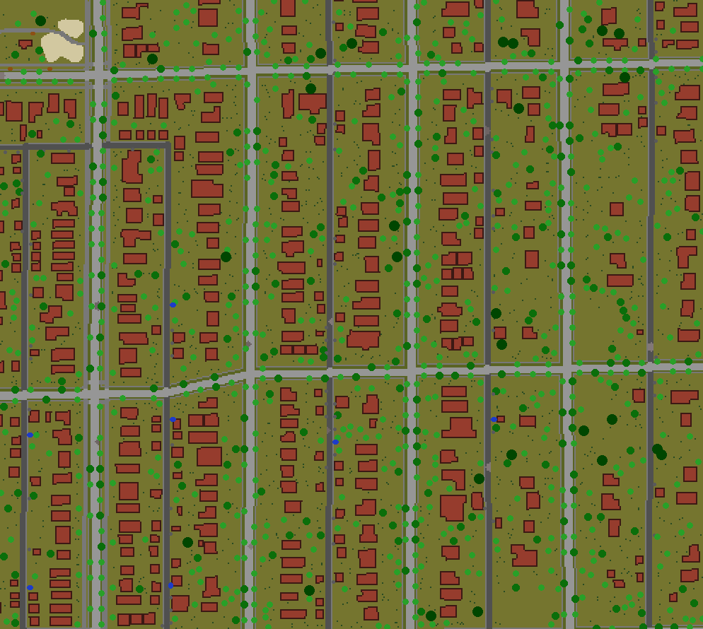
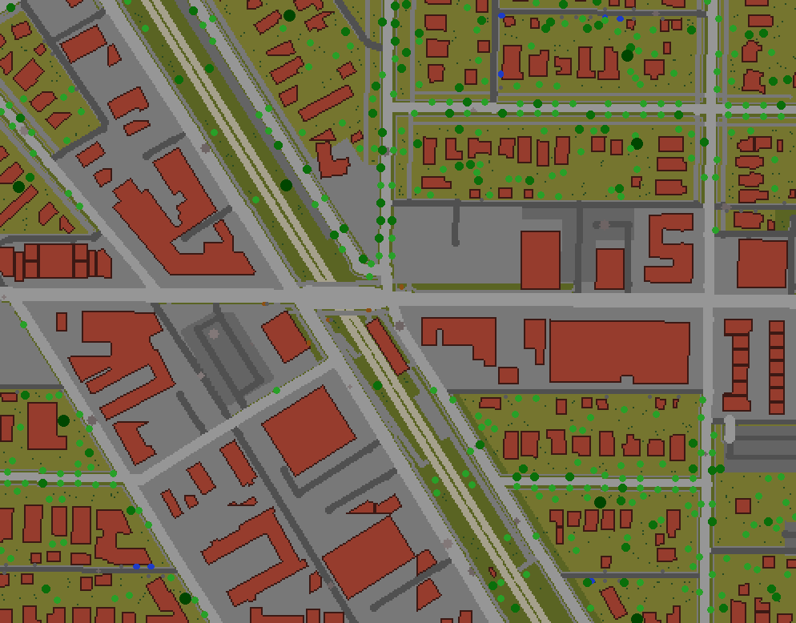
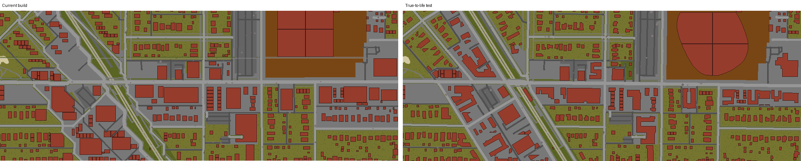
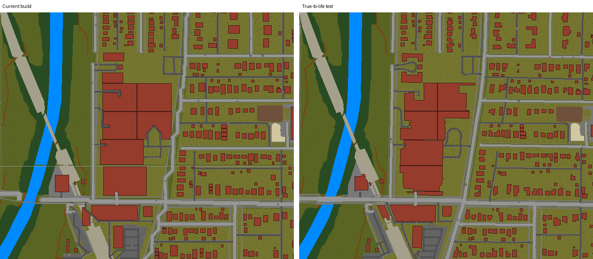
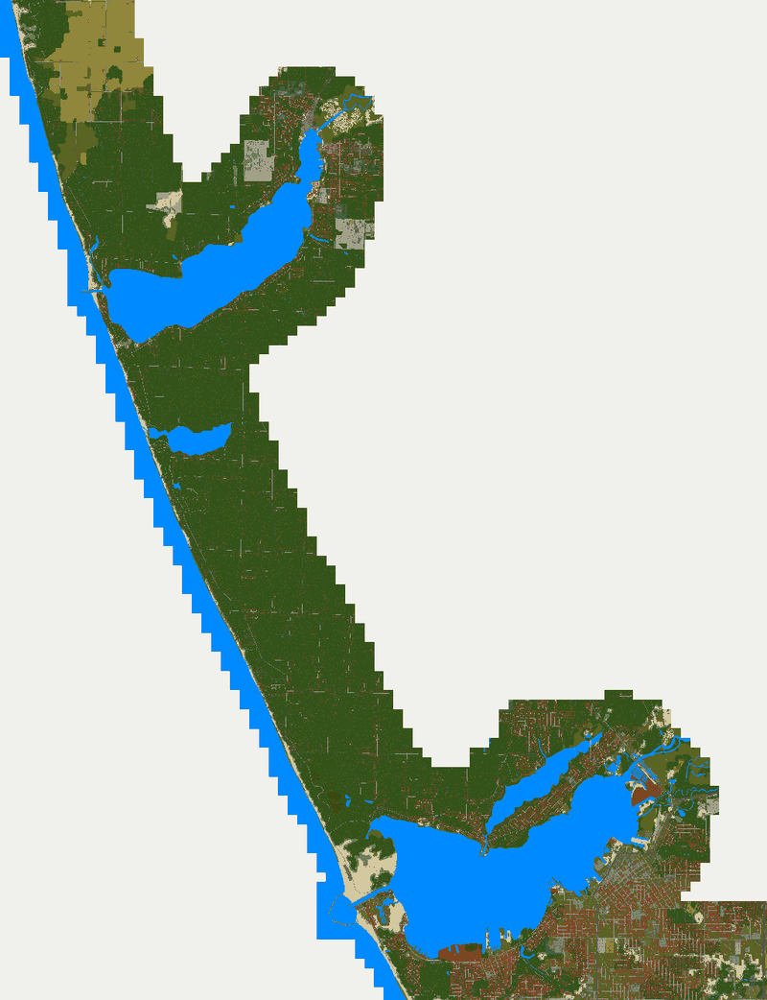
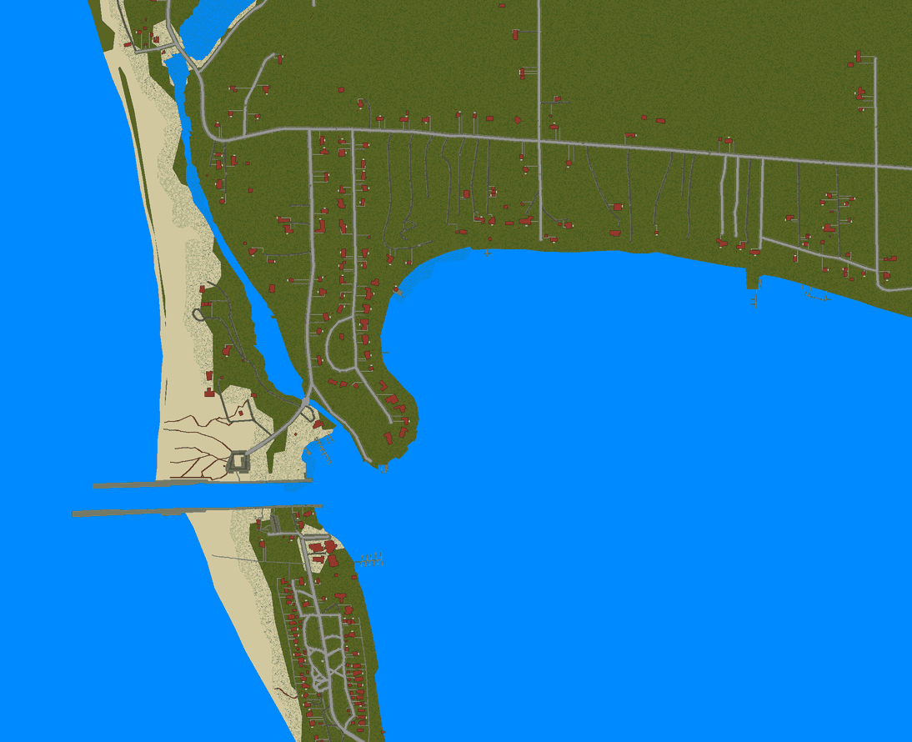
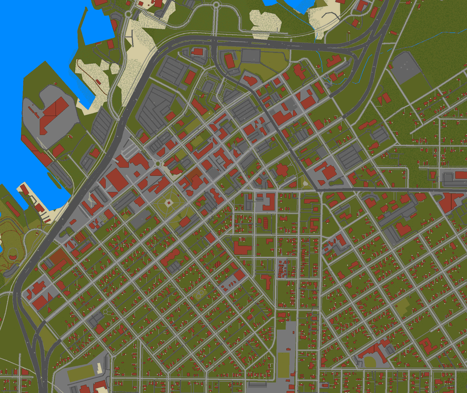

# Real places for Project Zomboid

Build 42 maps of real places at one tile to the metre, made with
[KnoxMap](https://github.com/badnew21/KnoxmapDM) from
[Overture Maps](https://overturemaps.org) data. KnoxMap itself is not changed.

| Map | What it is | Download |
|---|---|---|
| [Isle Royale](#isle-royale) | Isle Royale National Park, Michigan: 570 km² of island wilderness in Lake Superior | `release/IsleRoyale.7z.001`–`.005` (425 MB, 11 GB unpacked) |
| [Evanston](#evanston) | Evanston, Illinois: the whole city inside its real boundary, on Lake Michigan | `release/Evanston.7z` (41 MB, 690 MB unpacked) |
| [Evanston: Central Street test](#true-to-life-test-central-street) | North Evanston from Bent Park to Sheridan Road and down Ridgeway Avenue, built with real building outlines, street lines and heights | `release/EvanstonCentral.7z` (10 MB) |
| [White Lake to Muskegon](#white-lake-to-muskegon) | The Lake Michigan shore from Montague and Whitehall to Muskegon: White Lake and its channel, the beach houses, the dunes and the city of Muskegon | `release/WhiteLakeMuskegon.7z.001`–`.002` (177 MB, 2.7 GB unpacked) |

They sit side by side in the game world, so all of them can be installed at
once. See [Installing](#installing) for how to put one in the game.

# Isle Royale

A map of Isle Royale National Park, Michigan, at one tile to the metre. It
covers the whole island and its outer islands, from the Rock of Ages
lighthouse in the southwest to Passage Island in the northeast: about 570 km²
of land.


KnoxMap is made for towns of a few square kilometres, and the island is 86 km
long once it is laid out on the tile grid, so the pipeline hands KnoxMap the
island one piece at a time and stitches the pieces back together.

## What is on the map

- **The shoreline, over a hundred islands and rocks, and the inland lakes**: Siskiwit,
  Desor, Richie, Chickenbone, Feldtmann and the rest, with the streams between
  them.
- **Forest almost everywhere**, as on the real island, with bogs and wetlands,
  open rock ridges and a few beaches.
- **The trail network**: Greenstone Ridge, Minong Ridge, Feldtmann Ridge,
  Rock Harbor, Indian Portage and the access trails. Trails are bare dirt
  through the trees, and they are named on the in-game map like streets.
- **Rock Harbor, Mott Island and Windigo**: the lodge, cabins, store, ranger
  stations and docks. Each building is a furnished building, made by
  KnoxMap's knoxbuild on its real footprint.
- **Campgrounds** as clearings: Daisy Farm, Moskey Basin, Three Mile, Lake
  Desor, Chickenbone Lake and others.
- **Lighthouses and outlying buildings**: Rock of Ages, Isle Royale Light,
  Rock Harbor Light, Edisen Fishery and the fire towers.
- **An in-game map (M)** of the whole island, labelled with its harbours,
  lakes, islands, peaks, campgrounds and trails.
- **Zombies** where people would be: some at Rock Harbor and Windigo (KnoxMap's
  population estimate), a few along the trails and at the campgrounds, and
  almost none in the deep woods.

### Where you start

On the new-game screen you can choose where to start. Each place is its own
spawn region:

- **Rock Harbor** and **Windigo**, the ferry landings, starting inside one of
  their buildings.
- **20 campgrounds** along the trails, from Washington Creek and Huginnin Cove
  in the west to Daisy Farm, Moskey Basin and Lane Cove in the east, starting
  in the clearing.
- **Isle Royale** itself, for a random start at any of them.

Every start point is checked against the map as built: on a floor tile inside
a building that knoxbuild actually made, or on open grass with no tree,
building or water on it. All of them are on the main island, so nobody starts
somewhere they can't leave. Each region is a small map folder beside the
island's own (`Isle Royale - Daisy Farm Campground` and so on), the way
vanilla does Riverside and Rosewood: it borrows the island's lot files and has
its own spawn points (`pipeline/regions.py`).

### Things to know

- **The map stops 3 km inland.** Past the coast (and past 1.5 km from White
  Lake and Muskegon Lake) there is nothing: the edge of the map. The cut
  follows whole cells, so it is a stepped line, and it crosses Whitehall's
  east side and Muskegon's south-east neighbourhoods.
- **North is turned 30°.** The island runs southwest to northeast, so the map
  is rotated until that long axis runs left to right. A north-up frame would
  have been 65 × 40 km, mostly water.
- **Open lake is left out.** Every cell holding land keeps one cell (256 m) of
  water around it. Cells further out are not part of the map, since no one can
  get out there. Each of those empty cells would otherwise add about 300 KB of
  water to the mod.
- **The outer islands are out of reach.** Project Zomboid has no boats, so
  the Rock of Ages lighthouse, Passage Island and the outer islands can be
  seen from shore but not visited. The same goes for Mott Island and the
  islands across the Rock Harbor channel.
- **The woods are broadleaf only for now.** Trees are paper birch (most of
  them), red maple and linden, drawn from Build 42's per-species tree sheets.
  The real island is largely spruce and fir. Build 42 has hemlock and pine
  sheets, but they are laid out differently from the broadleaf ones and are
  left out until someone checks them in the game (`pipeline/rules.py`).
- **There is no elevation.** Build 42 maps are flat, so the ridges show only as
  bare rock and scrub.
- **The map is large.** See [Size](#size) below.

## Building it

You only need this to change the map or rebuild it from fresher data.
Nothing has to be done by hand. On 4 cores and 16 GB of memory the
whole build took about 40 minutes. It needs about 20 GB of free disk: 9 GB for
the two island-wide bitmaps and 11 GB for the lot files. On the same drive,
the mod folder hard-links the lot files instead of copying them.

You need:

- **KnoxMap** set up as its README describes (`Setup.bat`, or `./setup.sh` on
  Linux and macOS). Setup provides the Python environment and the PZ Mapping
  Tools. The pipeline reads the tools' `Rules.txt` and `Blends.txt`.
- **knoxlots**, KnoxMap's lot compiler. KnoxMap releases ship it beside
  `KnoxMap.exe`. In a git checkout, build it with
  `cargo build --release` in `rust/knoxlots`.
- **pyarrow** in KnoxMap's environment:
  `.venv\Scripts\python -m pip install pyarrow`

Then point the pipeline at KnoxMap and run it:

```bat
set KNOXMAP_DIR=C:\path\to\KnoxMap
%KNOXMAP_DIR%\.venv\Scripts\python pipeline\build_island.py --mods-dir %USERPROFILE%\Zomboid\mods
```

On Linux or macOS:

```sh
export KNOXMAP_DIR=~/KnoxMap
$KNOXMAP_DIR/.venv/bin/python pipeline/build_island.py --mods-dir ~/Zomboid/mods
```

Then enable **Isle Royale** under Mods and start a new game on it.

The stages run in order, and each one keeps its results under `work/`. If a
run stops, run the same command again to carry on. To redo one step after a
change, use `--stages`:

| Stage | What it does |
|---|---|
| `fetch` | Downloads the park's data from Overture Maps into `data/overture`. A copy is already checked in, so this is only needed for fresher data. |
| `terrain` | Draws the island in 2.4 km strips with KnoxMap's renderer and stitches them into one ground and one vegetation bitmap. |
| `buildings` | Draws each cluster of buildings again as its own KnoxMap map, runs knoxbuild on it, and pastes the result back. |
| `spawn` | Makes the zombie spawn map. |
| `papermap` | Writes the in-game map and its labels, and picks the start points for each spawn region. |
| `compile` | Compiles the lot files with knoxlots, a few rows of cells at a time. |
| `mod` | Packages the mod with KnoxMap's own `make_map_mod`, and adds a spawn-region folder for each place. |

`--workers N` sets how many processes compile at once. `--render-workers N`
sets how many strips are drawn at once; each takes about 2.5 GB.

## How it works

Everything is placed in one fixed frame: a rectangle of whole 300-tile cells
in UTM zone 16N, turned 30° about its centre (`pipeline/isle.py`). A window is
any rectangle of that frame. `SectionProjector` is a KnoxMap `Projector` that
places latitude and longitude on a window's pixels exactly where the whole
frame would put them, so windows drawn on their own line up to the tile. While
a window is rendered or built, KnoxMap's `Projector.build` returns that
window's projector, so the renderer and knoxbuild work on it as if it were an
ordinary map.

The data is [Overture Maps](https://overturemaps.org): OpenStreetMap's
coastline, lakes, wetlands, trails, docks and buildings, plus ESA WorldCover
forest cover. `pipeline/overture_fetch.py` reads the GeoParquet files straight
from Overture's public S3 bucket with HTTP range requests. It downloads only
the row groups that overlap the park, so no DuckDB is needed.
`pipeline/isle.py` turns the rows into KnoxMap's `OSMFeature`s with OSM tags,
so KnoxMap's own classifier and painters draw them.

The compile uses its own copy of the map tools' `Rules.txt`, with the forest
tiles set to Build 42 tree sheets (`pipeline/rules.py`). The tools' shipped
rules use a tree sheet Build 42 no longer has artwork for. This way the build
doesn't depend on KnoxMap's Setup having patched them, and the tools' own files
stay unchanged.

KnoxMap was written for towns, so `pipeline/tidy.py` adds a few wilderness
rules. Trees are cleared off the trails, campgrounds keep only a few trees,
and each building stands in a small grass clearing.

## Size

| | |
|---|---|
| Frame | 85,800 × 17,100 tiles (286 × 57 KnoxMap cells) |
| Land | about 570 km² |
| Build 42 cells compiled | 10,975 (of 22,500 in the frame; the rest are open lake) |
| Buildings | 198, plus their fences and docks (286 lots), in 25 clusters from Rock of Ages to Passage Island |
| Mod on disk | 11 GB |
| Build time | terrain 14 min, buildings 1 min, compile 27 min (4 cores) |

Project Zomboid needs extra memory for a map this size. KnoxMap writes a
`HOW TO PLAY.txt` into the mod that says how to give the game more.

# Evanston

Evanston, Illinois, at one tile to the metre: the whole city inside its real
boundary, about 20 km², from the Lake Michigan shore to the North Shore
Channel.


A town this size is what KnoxMap is made for, so it runs KnoxMap's own steps
the way the app does. `pipeline/build_town.py` feeds it Overture Maps data
instead of a live OpenStreetMap download.

## What is on the map

- **Every street**, at its real width, with pavements and kerbs. KnoxMap lays
  the streets in straight runs and 45° corners, like the game's own map.
- **21,582 buildings**, each furnished: 16,042 houses, 3,341 blocks of flats,
  588 shops, 179 school buildings, 55 churches, garages and sheds. Heights are
  real for 87% of them, up to 14 storeys downtown.
- **Shops and businesses inside them**: about 3,700 of Overture's places become
  the restaurants, cafes, bars, groceries, pharmacies, banks, clinics, salons,
  gyms and offices knoxbuild fits out. 425 buildings are furnished this way.
- **Northwestern University**, downtown, the lakefront parks and beaches, and
  Calvary Cemetery.
- **The CTA Purple Line and the Metra tracks**, with 47 bridges where roads
  and rail cross over each other.
- **22,146 parking spots**, so cars spawn on the streets and in the lots.
- **Zombies by population**, from KnoxMap's estimate of who lived and worked in
  each building. It is a city, so there are a lot of them: about 41% of the
  map's chunks have some.
- **An in-game map (M)** with 521 named streets.

### Things to know

- **The map stops 3 km inland.** Past the coast (and past 1.5 km from White
  Lake and Muskegon Lake) there is nothing: the edge of the map. The cut
  follows whole cells, so it is a stepped line, and it crosses Whitehall's
  east side and Muskegon's south-east neighbourhoods.
- **The map stops at the city line.** Outside Evanston's boundary, KnoxMap
  turns the neighbouring towns (Skokie, Wilmette, Chicago's Rogers Park) back
  into open ground. The main roads carry on across it.
- **The streets are slightly simplified.** KnoxMap's "Knox County roads"
  setting is on, so curves such as Sheridan Road become straight runs with 45°
  corners, a few metres off their real line.
- **Interiors are generic.** Rooms suit what a building is, not the real
  building's layout.
- **The data is Overture's.** Overture Maps is OpenStreetMap plus extras. The
  buildings and streets are complete, but businesses only appear where Overture
  places a point inside the building.

## Size

| | |
|---|---|
| Map | 5,700 × 6,000 tiles, 545 Build 42 cells |
| Mod on disk | 690 MB |
| Build time | render 2 min, knoxbuild 7 min, compile 15 min (4 cores) |

## Building it

```sh
$KNOXMAP_DIR/.venv/bin/python pipeline/build_town.py evanston --mods-dir ~/Zomboid/mods
```

The stages are `fetch`, `render`, `buildings`, `compile` and `mod`. The
Overture data for Evanston is checked in under `data/evanston`. Another town
can be added to `TOWNS` in `pipeline/build_town.py` with its name in
Overture's divisions, a box to fetch, KnoxMap settings and a free spot in the
world.

## True-to-life test: Central Street

`release/EvanstonCentral.7z` (10 MB) is north Evanston around Central Street
built as close to the real buildings as KnoxMap can get, as a trial before
rebuilding the whole city that way:

- **Real outlines and angles** (`building_alignment = "real"`). The full
  Evanston build squares most buildings onto the grid; here every outline
  keeps its mapped shape, notches and angle.
- **Real street lines** (`straight_roads = 0`). Streets stay where they are,
  instead of being laid out in straight runs and 45° corners, so the
  buildings beside them don't move.
- **Real heights, uncapped** (`max_levels = 30`).

It covers Central Street from just west of Bent Park to Sheridan Road, and
Ridgeway Avenue for five blocks south of Central (Harrison, Colfax, Grant,
Golf, Foster) with the houses on both sides. Along the way are the Central
Street shops, the Metra and CTA Central stations, Evanston Hospital, Ryan
Field and the streets of houses around them: 5,777 buildings in 136 cells. It
sits beside Evanston in the game world, so both can be installed together.



### Street details and tall trees

The test also has the set dressing KnoxMap doesn't place on its own
(`pipeline/details.py`), plus more wear on the streets than KnoxMap's
defaults:

- **Street trees**: 9,777 in the grass verge between kerb and pavement on the
  residential streets, about 11 m apart, one species to a street (linden,
  red maple or birch), the way a city plants them.
- **Taller trees**: 13,363 of KnoxMap's single garden and park trees replaced
  by Build 42's Jumbo, XL and XXL trees, the largest mostly in the parks.
  Woods keep their normal trees, since giant trees packed together would
  overlap.
- **Alleys**: 1,341 trash cans behind the garages and 186 dumpsters.
- **Benches**: 54 at the mapped bus stops, each with a bin, and 175 along park
  paths.
- **Wear**: three times KnoxMap's litter, twice the cracks and a bit more
  grime, and 40% more parked cars.

Every tile comes from the map tools' own furniture list or is one KnoxMap
already checked against the game's sprites. Jumbo trees go in as their main
`_0` tile, from which the game builds the rest of the tree, as the mapping
tools' notes on Build 42 Jumbo trees describe. A `WorldGenOverride.lua` in
the map folder stops world generation from replacing them. Stop signs and
traffic lights are left out because the road-sign sheet isn't labelled.

Below, Jumbo trees are green (darker and larger for XL and XXL), cans grey,
dumpsters blue and benches brown:





`pipeline/details_picture.py` draws these for any box.

The pictures below show the same ground from both builds, with each building
drawn as the floor plan knoxbuild actually built. On the left is the current full
Evanston build; on the right is the test.





`pipeline/compare.py` draws these pictures for any two builds and any
latitude/longitude box.

# White Lake to Muskegon

The Lake Michigan shore of Muskegon County, Michigan, at one tile to the
metre. It runs from Montague, Whitehall and the White River in the north,
down 27 km of shore past White Lake, Duck Lake and Muskegon State Park, to
North Muskegon, Muskegon Lake and the city of Muskegon.

It is the coast only: the land within 3 km of Lake Michigan, and White Lake,
Muskegon Lake and Bear Lake with 1.5 km of shore round the first two and 1 km
round Bear Lake. That takes in Whitehall, Montague and downtown Muskegon,
and leaves out the farms and woods inland.



## What is on the map

- **White Lake and its channel**, with the piers out into Lake Michigan, the
  beach and dune paths on both sides, the docks along the shore, and the
  cottages and beach houses on the roads round the lake.
- **The White River Light Station**, the 1875 lighthouse on the south side of
  the channel. The brick keeper's house is a building you can walk into (it
  is a museum now), and its four-storey tower stands at the lake end.
- **Whitehall and Montague**: Colby Street and Dowling Street, the Playhouse,
  the armory, the schools and the streets of houses on both sides of the
  river mouth.
- **The shore down to Muskegon**: Duck Lake, Muskegon State Park's dunes, the
  Muskegon Lake channel and Pere Marquette beach.
- **North Muskegon and Muskegon**: downtown on its diagonal grid, Western
  Avenue, Hackley Park, the waterfront and the neighbourhoods round them.
- **Every street and building in Overture Maps** along the coast: 26,639
  furnished buildings, with rows of shops and terraces split into their
  units. Heights are real for about 80% of them, and outlines keep their
  real shape and angle.
- **Open woods of tall trees**, farmland, wetland and dunes from ESA
  WorldCover, with lakes, ponds, rivers and streams from OpenStreetMap.
- **An in-game map (M)** with the towns, lakes, parks and named streets.
- **Zombies by population**, from KnoxMap's estimate of who lived and worked
  in each building.





### Buildings along the shore

KnoxMap picks each house's walls from how built-up its street is. That would
put brick and stucco on the lake cottages, so the walls are set where the
building stock is known (`pipeline/styles.py`):

- **Within 250 m of Lake Michigan, and 130 m of White Lake, Duck Lake, Bear
  Lake and Muskegon Lake**, every house is timber-framed and sided:
  clapboard, painted boards, and grey, blue, yellow or green siding, with the
  odd log cabin and almost no brick.
- **The old downtowns** of Whitehall (Colby Street), Montague (Dowling Street)
  and Muskegon (Western Avenue) are mostly brick commercial blocks.
- **Named landmarks** get their own walls: the light station in brick, the
  Life-Saving Station and the Playhouse in clapboard.

Each building gets its walls from where it stands, so a building on the
line between two parts of the build comes out the same from both.

### Inside the buildings

Most outlines here are machine-detected, with no use on them, so on its own
KnoxMap builds nearly all of them as houses. Two things in
`pipeline/region.py` make the insides fit better:

- **Garages and sheds.** An untagged outline of 30–85 m² within 20 m of a
  building at least twice its size is a detached garage, and one of 6–30 m²
  a garden shed, unless three or more buildings of about its own size stand
  within 30 m: a row like that is a colony of cottages, such as the
  Wabaningo Club's on Murray Road, not a house's garages. About 3,600
  garages and 1,000 sheds across the whole area are built as one-room
  outbuildings instead of two-room houses.
- **Real garage doors** (`pipeline/garages.py`). knoxbuild gives a garage
  its way in for a car as three ordinary doors side by side. Each of those
  is replaced with the game's own three-tile garage door (`walls_garage_01`,
  as the map tools place it), and whatever was furnished just inside it is
  cleared.
- **Houses, not flats.** A machine-measured height is to the roof ridge, so a
  two-storey house under a steep roof read as three storeys, and KnoxMap
  builds anything of three storeys as a block of flats. Small houses and
  small untagged outlines (under 300 m²) are capped at two storeys, and
  nothing on the shore or the lakes is built as flats.
- **Businesses in their buildings.** knoxbuild fits out a shop, restaurant,
  bar, office or clinic only where a business point is inside the outline.
  Overture puts many of them on the street out front, so each one within
  25 m of a building of 40 m² or more is moved into it. In downtown Muskegon
  that takes the fitted-out businesses from 102 to 138.

### Loot

The towns are built at their real density and every house is furnished, so
with the game's own loot tables in every cupboard and fridge there was far
more to find than in vanilla. `pipeline/whitehall_loot.lua`, shipped in the
mod, keeps about a third of what the game puts in each container on this map
when the container is first filled, and leaves anything a player puts there
alone. It only acts on this map's tiles, and the guaranteed rifle is always
left. To change the amount, edit `KEEP` near the top of
`common/media/lua/server/KnoxMap/WhiteLakeMuskegon_Loot.lua` in the mod
folder (1 gives the game's own amounts back). The game's own loot rarity
setting still applies on top.

### Trees, flowers and the streets

The woods are thinned and given tall trees (`pipeline/woods.py`):

- **Open woods.** The map tools paint full woodland as a tree on every tile.
  Here a wood keeps one tree in five on its densest tiles, fewer towards its
  edges, and the rest is long grass or open ground. Scrub keeps about a
  third. Single trees in gardens are left as they are.
- **Tall trees through them**: Build 42's Jumbo, XL and XXL trees, about one
  in every 90 m² of wood. Inland they are mostly red maple and basswood, with
  birch, hemlock and pine; within 2 km of Lake Michigan hemlock and pine make
  up most of them. The regular trees round each one are cleared, so trunks
  don't overlap.
- **Pines on the dunes**: a thin scatter of Virginia pines on the open sand
  near the lake.
- **Big garden, park and street trees** (`pipeline/details.py`): a street tree
  in the verge every 11 m on residential streets, and 95% of single garden
  and park trees swapped for Jumbo maples, basswoods, birches, hemlocks and
  pines, mostly XL and XXL in the parks.
- **Flower beds** along the lawn side of about one building in eight. The
  map tools' long-grass rules mix a few groundcover plants into the grass,
  which the Build 42 tree fix in `pipeline/rules.py` turns into flower beds;
  for this map they are left out, so the long grass under the woods is just
  grass.
- **Tidy streets.** Half KnoxMap's usual litter, and less cracking and grime.

The forest fill is red maple, American basswood (linden) and birch, from
Build 42's per-species sheets. Every Jumbo tree is placed as its sheet's main
`_0` tile, which is how the map tools' Build 42 notes say to place one. A
`WorldGenOverride.lua` in the map folder stops world generation from
replacing them.

### Where you start

On the new-game screen you can choose **Whitehall**, **Montague**, the
**White Lake Channel**, **North Muskegon**, **Muskegon** or **Lakeside**, each a spawn region of its own with start points inside homes
built there. **White Lake to Muskegon** itself is a random start at any of
them.

### Things to know

- **The map stops 3 km inland.** Past the coast (and past 1.5 km from White
  Lake and Muskegon Lake) there is nothing: the edge of the map. The cut
  follows whole cells, so it is a stepped line, and it crosses Whitehall's
  east side and Muskegon's south-east neighbourhoods.
- **North is up.** The frame is turned only by the half degree between UTM
  grid north and true north, so Muskegon's streets run along the tiles.
- **Most footprints are machine-detected.** About 86% of the outlines are
  Microsoft's building footprints from aerial imagery, via Overture Maps.
  They have real heights but no names or uses, so most are built as houses.
- **The woods come from satellite land cover.** ESA WorldCover maps much of
  the land between the towns as forest, including some farmland and the
  wooded lots the houses stand in. KnoxMap clears a yard round each building.
- **Interiors are generic.** Rooms suit what a building is, not its real
  floor plan.
- **There is no elevation.** Build 42 maps are flat, so the dunes are sand
  and scrub at ground level.

## Building it

```sh
export KNOXMAP_DIR=~/KnoxMap
$KNOXMAP_DIR/.venv/bin/python pipeline/build_whitehall.py --mods-dir ~/Zomboid/mods
```

The data for the region is checked in under `data/whitehall`. The stages are:

| Stage | What it does |
|---|---|
| `windows` | Cuts the map into cores of 10 × 10 cells (3 km a side). Each core is rendered and built as its own KnoxMap map, with a 300 m margin round it so buildings, yards and fences near the edge are laid out with their neighbours. |
| `paste` | Stitches the cores into one ground, vegetation and zombie bitmap and one WorldEd project. It keeps each building whose lot is centred in its core, whole, plus the props, fences and zones of the core's own cells, and drops whatever is off the coast. |
| `papermap` | Writes the in-game map, the map's info and the start points. |
| `compile` | Compiles the lot files with knoxlots, a few rows of cells at a time. |
| `mod` | Packages the mod and adds a spawn-region folder for each town. |

The whole frame is rendered and built either way. `COAST_ONLY` in
`pipeline/build_whitehall.py` decides what goes into the mod: the coast
(`region.coast_utm`, with its reach set at the bottom of `pipeline/region.py`)
or all of it, about 6,500 cells and 6.5 GB.

`--build-workers N` sets how many windows are built at once; each takes 1–2
GB. `--only w05_06,w06_06` rebuilds just those windows. Delete a window's
`kept.json` to build it again.

## Size

| | |
|---|---|
| Frame | 21,300 × 26,700 tiles (71 × 89 KnoxMap cells) |
| On the map | the coast, about 170 km² of land and lake |
| Buildings | 26,639 |
| Build 42 cells compiled | 2,867 |
| Mod on disk | 2.7 GB |
| Build time | windows 13 min, paste 3 min, compile 22 min (4 cores) |

Project Zomboid needs extra memory for a map this size. KnoxMap writes a
`HOW TO PLAY.txt` into the mod that says how to give the game more.

# Installing

The maps are in [`release/`](release) as 7-Zip archives. Isle Royale and
White Lake to Muskegon are split into parts (`IsleRoyale.7z.001`,
`.002`, ...) to stay under GitHub's file size limit.

1. Download the archive. For a split one, download every part into one folder.
2. Open it with [7-Zip](https://www.7-zip.org): `Evanston.7z`, or the
   `.001` part of a split one, which reads the other parts by itself. On
   Linux, use `7z x <file>`.
3. Extract the folder inside (`Evanston`, `IsleRoyale`, `WhiteLakeMuskegon`
   and so on) into your Zomboid
   mods folder: `%USERPROFILE%\Zomboid\mods` on Windows, `~/Zomboid/mods` on
   Linux and macOS.
4. Start Project Zomboid (Build 42), enable the map under Mods, and start a
   **new** game on it.

If you downloaded Isle Royale before the start locations were added, you
don't need the whole archive again. Extract
`release/IsleRoyale-spawn-regions-update.zip` (17 KB) into your mods folder
over the existing `IsleRoyale` folder and let it replace files. Then start a
new game.

Read `HOW TO PLAY.txt` in the mod folder first. Maps this size need more
memory than the game gives itself by default, and the file says how to raise
it.

# Credits and licences

- Map data © OpenStreetMap contributors, under the
  [ODbL](https://www.openstreetmap.org/copyright), as published by Overture
  Maps. Evanston's boundary is from Overture Maps' divisions theme.
- Forest cover © ESA WorldCover project 2021, contains modified Copernicus
  Sentinel data, [CC BY 4.0](https://creativecommons.org/licenses/by/4.0/),
  via Overture Maps.
- Building footprints and heights for most of White Lake to Muskegon are
  Microsoft's ML building footprints, under the ODbL, via Overture Maps.
- [KnoxMap](https://github.com/badnew21/KnoxmapDM) by euclid80tr, MIT. It is
  built on Knoxify by arytek and on the PZ Mapping Tools by Alree/Unjammer
  (TileZed and WorldEd by Tim Baker).
- Project Zomboid is a trademark of The Indie Stone. This is an unofficial fan
  map and contains no game files.

These are real places. The zombies are made up, and so is everything inside
the buildings. Isle Royale's wolves and moose are real, but they are not in
the game.
