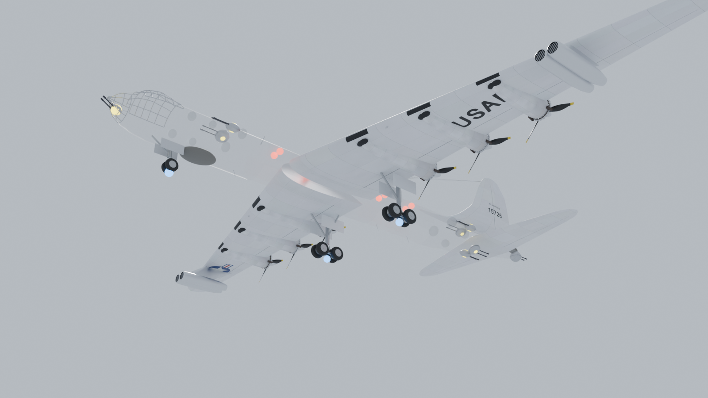

# B-36 Peacemaker for Nuclear Option

A flyable Convair B-36J for [Nuclear Option](https://store.steampowered.com/app/2168680/Nuclear_Option/),
built on the 3D model from [noahdemar/b36](https://github.com/noahdemar/b36). It is a
[Blueprinter](https://github.com/nikkorap/NOBlueprinter-Releases) mod, plus a small BepInEx
plugin that animates the exterior.



What the aircraft has:

- Four bomb bays, each its own hardpoint set ("Bomb Bay 1" to "Bomb Bay 4") with two
  stations on the bay roof. Each bay is a copy of the base aircraft's internal bay, so it
  takes the same weapons and opens its doors before release. The roll-up B-36 doors follow
  the game's doors.
- A "Defensive Turrets" set with eight stations at the B-36's turret positions: nose, tail,
  two upper forward, two upper aft and two lower aft. They carry a native turret gun, so the
  game's own turret code aims and fires them. The B-36 turrets rise out of the fuselage,
  track the native guns and stow again after 8 seconds idle.
- Landing gear on the B-36 nose wheel and four-wheel main bogies, at the right sizes.
- Moving control surfaces, flaps, six spinning propellers, and jet effects moved onto the
  four jet pods.

The flight model, cockpit and systems come from the SFB-81 Darkreach, which is the closest
thing the game has to a heavy bomber with internal bays. So the B-36 flies like a Darkreach,
not like a 1950s piston bomber.

## Status: built here, not yet flown

I couldn't run Unity or the game in the environment where I wrote this, so nobody has loaded
this mod in Nuclear Option yet. Here is what I did check:

- `tools/test_rig.py` compares every hinge, turret axis and aim angle in the Unity-space rig
  against the source model. All 40 moving parts and 8 turrets match, and the test does catch
  a deliberately flipped axis.
- The converter re-imports its own FBX and checks names and scale (nose to tail turret
  47.72 m).
- The plugin compiles against the real UnityEngine assemblies. The editor scripts compile
  against UnityEngine plus stand-ins for the UnityEditor and Blueprinter calls they make.
- The preview above is the converted model with the bays and stations as the builder places
  them.

The part I can't check from here is how the game's own components behave once rearranged.
The builder reaches them by field name (`hardpointSets`, `bayDoors`, `weaponOptions`,
`LandingGear.wheelRadius` and so on), the same way Blueprinter and the
[F-4E mod](https://github.com/Braianvladzgrid/F4E-Phantom-NuclearOption) do, and it stops with
a named error when something doesn't match. If it does stop, run "Audit base aircraft" and
send me `Logs/B36Peacemaker_build.txt`. That file lists the Darkreach's hierarchy, hardpoints
and turret weapon candidates, which is what I need to fix it.

Known gaps:

- Hitboxes and colliders still belong to the Darkreach, so the B-36's outer wings won't take
  hits or touch the ground.
- The turret weapon is whichever native turret gun the builder rates best: mounts already fitted to an
  aircraft, with a Gun component, and not a missile. You can choose another one in the
  window. Whether the guns engage on their own or only at your locked target depends on the
  game's turret logic.
- In cockpit view you see the Darkreach cockpit.
- The source repository has no licence file. Ask its author before you publish a build. This
  repo keeps none of the model's meshes or textures; the converter downloads them.

## Building it

You need Nuclear Option with BepInEx 5 and Blueprinter 2.0.1 or later, plus a Blueprinter
Editor project set up for your game version (Unity 2022.3.62f2, see the
[Blueprinter Editor guide](https://github.com/nikkorap/NOBlueprinter-Editor/blob/main/GUIDE.md)).
You also need [uv](https://docs.astral.sh/uv/) for the converter and the .NET SDK for the
plugin.

1. Convert the model into the Blueprinter project:

   ```
   cd nuclear-option-b36/tools
   uv run python convert_b36.py --out "<BlueprinterProject>/Assets/Blueprinter/Mods/B36Peacemaker/Art"
   uv run python test_rig.py .cache/b36 "<BlueprinterProject>/Assets/Blueprinter/Mods/B36Peacemaker/Art/b36_rig.json"
   ```

   This clones noahdemar/b36 at a pinned commit and writes `B36.fbx`, the textures,
   `b36_rig.json` and `b36_materials.json`. It also refreshes `plugin/b36_rig.json`.

2. Copy `unity/Assets/Editor/B36Peacemaker` into the project's `Assets/Editor/`.

3. In Unity, open "B-36 > Builder". Click "Audit base aircraft" first and read the report.
   Then click "Build aircraft", set an output folder, and click "Build .nobp". The builder writes
   `B36_Peacemaker.prefab`, its definition and a hangar op into the mod folder. The hangar op
   puts the B-36 in every hangar; edit `Ops/OpAddB36ToHangars.asset` to narrow that down.

4. The plugin is prebuilt at `release/B36Peacemaker.dll` (built against BepInEx 5.4.23.2).
   To build it yourself, copy `plugin/Directory.Build.props.template` to
   `plugin/Directory.Build.props`, set `GamePath`, then run `dotnet build -c Release` in `plugin/`.

5. Put `B-36 Peacemaker_<version>.nobp` and `B36Peacemaker.dll` in `BepInEx/plugins/`.

The aircraft works without the plugin, but its doors, gear, turrets and propellers won't
move.

## How the pieces fit

```
tools/convert_b36.py   glTF -> FBX, Unity-ready textures, and the rig (every hinge, turret,
                       wheel and bay in Unity model space: +X right, +Y up, +Z nose)
tools/test_rig.py      checks the rig against the source glTF
tools/render_layout.py the preview image
unity/Assets/Editor/B36Peacemaker/
  B36Builder.cs        clones the base aircraft, hides its renderers, fits the B-36 model
                       to the rig from named landmarks, rebuilds the hardpoint sets, moves
                       the gear and effects, writes the definition and hangar op
  B36Window.cs         the B-36 > Builder window and settings
plugin/                BepInEx plugin: finds spawned B-36s by their B36_RigFrame and drives
                       the model from the hidden native parts
```

The builder leaves name markers for the plugin. `B36_Src_*` sits under each native bay door,
gear leg and turret station, and `B36_Rest_*` under the rig frame records each part's prefab
pose. The plugin compares the two to work out how far a door or leg has moved, so it doesn't need
any game types. The names are listed in `Markers` in `plugin/B36Animator.cs`.

Rig numbers come from the source project: bay positions and fuselage size, turret limits
and slew rate, 25 degree surfaces, 40 degree flaps, gear fold angles and the centre of
gravity at about 30% MAC.
